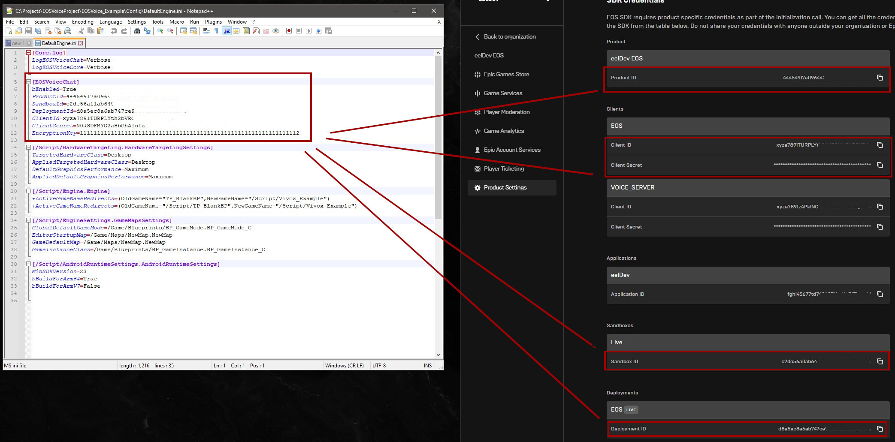

# DefaultEngine.ini

Open up your Project\Config\DefaultEngine.ini file with Notepad, copy-paste the values below and replace them with your own values from the Developer Portal

```ini
[EOSVoiceChat]
bEnabled=True
ProductId=<your ProductId>
SandboxId=<your SandboxId>
DeploymentId=<your DeploymentId>
ClientId=<your ClientId>
ClientSecret=<your ClientSecret>
EncryptionKey=<64 hexadecimal characters>
```

