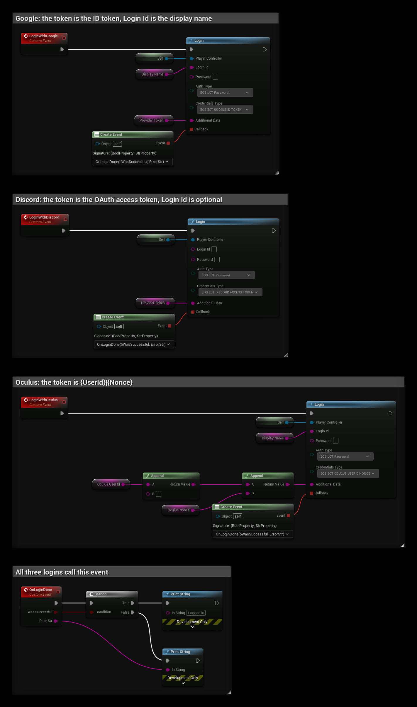

# Authentication: Other Identity Providers

- **[Read more about this authentication method here](https://dev.epicgames.com/docs/epic-online-services/eos-fundamentals/connect-interface)**

:::warning
Requires EOSCore 2.0.0 and later.
:::

The **Login** node can log in with a token from any identity provider that EOS supports. Your game gets the token from the provider's own SDK and passes it to the node. EOSCore then logs in with the Connect interface and creates the EOS user the first time.

## Requirements
- The identity provider must be added to your product in the EOS Developer Portal, under **Product Settings > Identity Providers**, and enabled for the sandbox.
- A way to get the token in your game, usually the provider's SDK or plugin.

## Settings
```
AuthType: EOS_LCT_Password
Credentials Type: <the provider, see the table>

Login Id: The player's display name (required for some providers, see the table)
Password: <not used>
Additional Data: The token
```

| Credentials Type | Token in Additional Data | Login Id |
|---|---|---|
| `EOS_ECT_APPLE_ID_TOKEN` | Sign in with Apple ID token | Required |
| `EOS_ECT_GOOGLE_ID_TOKEN` | Google Sign-In ID token | Required |
| `EOS_ECT_AMAZON_ACCESS_TOKEN` | Login with Amazon access token | Required |
| `EOS_ECT_OCULUS_USERID_NONCE` | `{UserId}\|{Nonce}` from the Meta Platform SDK | Required |
| `EOS_ECT_DISCORD_ACCESS_TOKEN` | Discord OAuth access token | Optional |
| `EOS_ECT_GOG_SESSION_TICKET` | GOG Galaxy encrypted app ticket | Optional |
| `EOS_ECT_UPLAY_ACCESS_TOKEN` | Ubisoft Connect access token | Optional |
| `EOS_ECT_ITCHIO_JWT` / `EOS_ECT_ITCHIO_KEY` | itch.io JWT or API key | Optional |
| `EOS_ECT_VIVEPORT_USER_TOKEN` | Viveport user token | Optional |
| `EOS_ECT_EPIC_ID_TOKEN` | Epic Account ID token, for example from **EOS_Auth_CopyIdToken** | Optional |
| `EOS_ECT_OPENID_ACCESS_TOKEN` | Token from your own OpenID provider | Optional |
| `EOS_ECT_PSN_ID_TOKEN`, `EOS_ECT_XBL_XSTS_TOKEN`, `EOS_ECT_NINTENDO_ID_TOKEN`, `EOS_ECT_NINTENDO_NSA_ID_TOKEN` | Token from the console SDK | Required for Nintendo |

Steam has its own pages: [Steam App Ticket](./auth_steam.md) and [Steam Session Ticket](./auth_steam_session.md).

The **Login Id** is sent to EOS as the display name. EOS shows it to other players, for example in leaderboards. It is not part of the authentication.

## Errors
The **Callback** returns **bWasSuccessful** false with an error message when:
- **Additional Data** is empty.
- EOS rejects the token, for example because the identity provider is not set up in the Developer Portal or the token has expired.
- The Connect login fails for another reason. Before EOSCore 2.0.0, failed Steam and OpenID logins never called the **Callback**; now every failed login does.

## Example


The example is in a Player Controller and uses the variables **Display Name** and **Provider Token**. Get the token from the provider's SDK before you call the event.

1. **LoginWithGoogle** passes the Google ID token in **Additional Data** and the display name in **Login Id**, which Google requires.
2. **LoginWithDiscord** passes the Discord access token. **Login Id** is optional, so it is left empty.
3. **LoginWithOculus** builds the token as `{UserId}|{Nonce}` with two **Append** nodes. The user id and nonce come from the Meta Platform SDK.
4. All three bind **OnLoginDone** to **Callback**. It prints **Error Str** when **Was Successful** is false.

Connect **Self** (or your Player Controller) to **Player Controller**, so EOSCore sets the player's Unique Net Id after the login.
