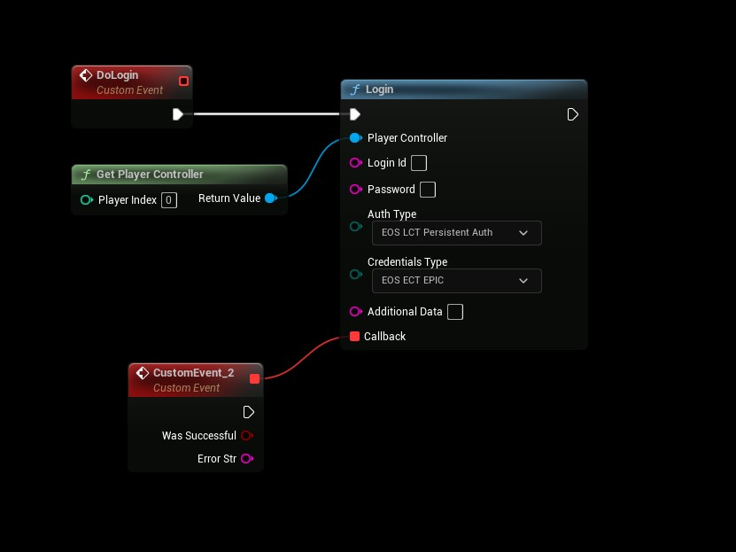

# Authentication: Persistent Auth
- **[Read more about this authentication method here](https://dev.epicgames.com/docs/epic-online-services/accounts-and-social/eos-epic-account-services/auth-interface)**

## Persistent Authentication (Use previous successful login)
- Use the following settings
```
AuthType: PersistentAuth
CredentialsType: Epic

Login Id: not used
Password: not used
Additional Data: not used
```

