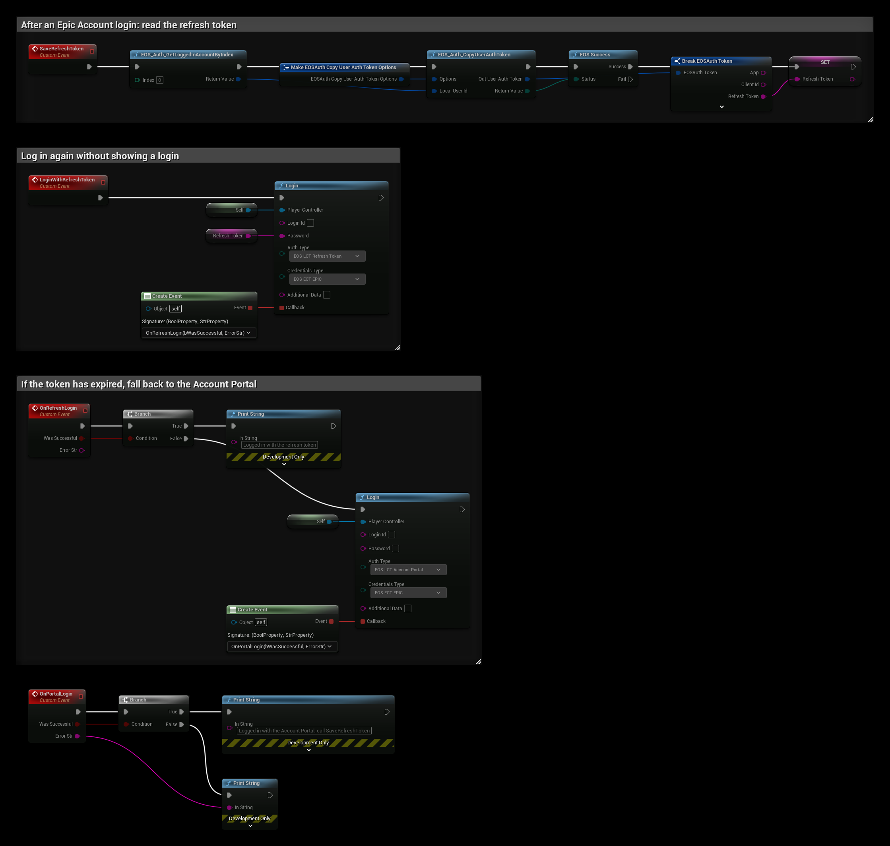

# Authentication: Refresh Token

- **[Read more about this authentication method here](https://dev.epicgames.com/docs/epic-online-services/accounts-and-social/eos-epic-account-services/auth-interface)**

:::warning
Requires EOSCore 2.0.0 and later.
:::

A refresh token logs the player in to their Epic Account again without showing a login. EOS returns the refresh token after an Epic Account login. Use it when you store the login yourself, for example on a platform where **Persistent Auth** is not available.

## Getting the refresh token
After a successful Epic Account login, call **EOS_Auth_CopyUserAuthToken** and read **Refresh Token** from the result. Store it securely, it gives access to the player's account.

## Settings
```
AuthType: EOS_LCT_RefreshToken
Credentials Type: EOS_ECT_EPIC

Login Id: <not used>
Password: The refresh token
Additional Data: <not used>
```

Refresh tokens expire. If the login fails, log the player in again with another method, for example [Account Portal](./auth_epic.md).

## Example


The example is in a Player Controller and keeps the token in the **Refresh Token** variable. Save it in your own save game between runs.

1. **SaveRefreshToken** runs after an Epic Account login. **EOS_Auth_GetLoggedInAccountByIndex** gets the logged in account, and **EOS_Auth_CopyUserAuthToken** copies its token. When the copy succeeds, **Refresh Token** is read from the token.
2. **LoginWithRefreshToken** calls **Login** with **EOS_LCT_RefreshToken**, **EOS_ECT_EPIC** and the token in **Password**.
3. **OnRefreshLogin** prints a message when the login succeeds. When it fails, for example because the token has expired, it logs in with the **Account Portal** instead.
4. **OnPortalLogin** is called when the Account Portal login completes. Call **SaveRefreshToken** again after it, since the old token no longer works.

To use a refresh token for the automatic login, start the game with `-AUTH_TYPE=refreshtoken -AUTH_TOKEN=<token>`, see [Command Line Arguments](../../commandline_arguments.md).
