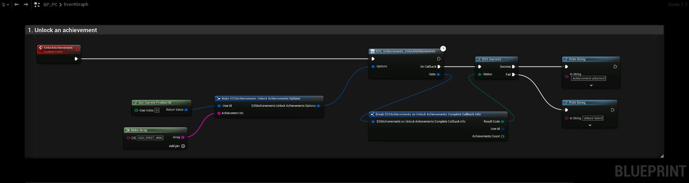
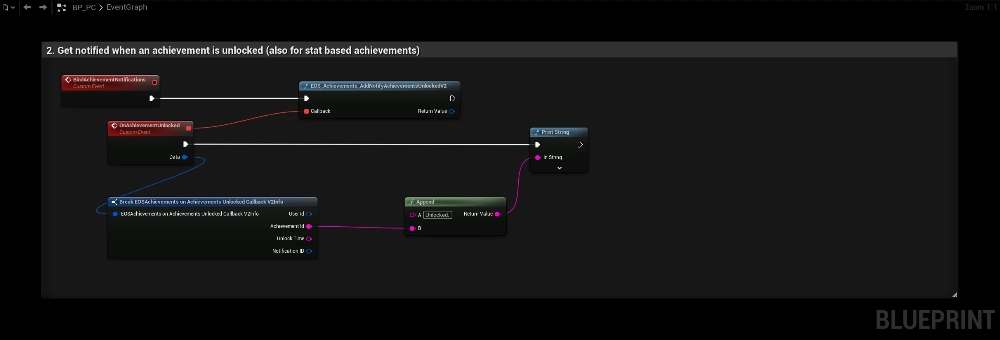
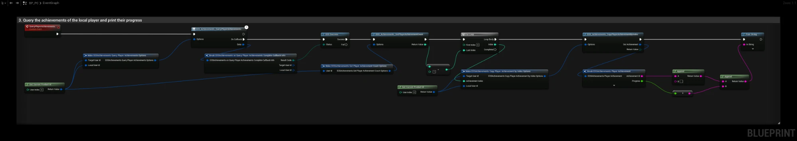

# Achievements

:::info Video Tutorial is available
[Achievements video](../videos/achievements.mdx)
:::

Achievements are defined in the Developer Portal (**Game Services > Achievements**). An achievement is either unlocked by your game directly, or automatically by EOS when one or more [Stats](./stats.md) reach a threshold.

- [EOS Achievements documentation](https://dev.epicgames.com/docs/epic-online-services/player-and-game-data/achievements-interface)

## Requirements
- A logged in user with a **Product User Id** (Connect login), see [Authentication](../getting_started/auth/information.md)
- The **Achievements** feature allowed in your client policy

## Common Nodes

| Node | Use |
|---|---|
| `EOS_Achievements_QueryDefinitions` | Downloads all achievement definitions (names, descriptions, icons, thresholds) |
| `EOS_Achievements_GetAchievementDefinitionCount` + `EOS_Achievements_CopyAchievementDefinitionV2ByIndex` | Reads the downloaded definitions |
| `EOS_Achievements_QueryPlayerAchievements` | Downloads the progress and unlock state for a player |
| `EOS_Achievements_GetPlayerAchievementCount` + `EOS_Achievements_CopyPlayerAchievementByIndex` | Reads the player's achievements |
| `EOS_Achievements_UnlockAchievements` | Unlocks one or more achievements by id |
| `EOS_Achievements_AddNotifyAchievementsUnlockedV2` | Called when an achievement was unlocked, also for stat based unlocks |

## Typical Flow
1. After login, call **QueryDefinitions** once and cache the result.
2. Call **QueryPlayerAchievements** for the local player to show progress.
3. Unlock achievements with **UnlockAchievements**, or ingest the stats they depend on with `EOS_Stats_IngestStat`.
4. Listen to **AddNotifyAchievementsUnlockedV2** to show a notification in game.

:::tip
Stat based achievements are not unlocked right away. EOS processes ingested stats on the backend, the unlock can take a few seconds.
:::

## Example

### Unlocking an achievement

The **UnlockAchievement** event unlocks `ACH_FIRST_WIN` for the local player. **Achievement Ids** is an array, so you can unlock several achievements in one call.

### Getting notified about unlocks

Call **BindAchievementNotifications** once after login, for example from the Game Instance. **EOS_Achievements_AddNotifyAchievementsUnlockedV2** then calls **OnAchievementUnlocked** for every unlock, both for achievements you unlock yourself and for stat based achievements that EOS unlocks on the backend. Keep the returned **Notification Id** if you want to remove the notification later with **EOS_Achievements_RemoveNotifyAchievementsUnlocked**.

### Reading player progress

The **QueryPlayerAchievements** event downloads the achievements of the local player and prints the id and progress of each one:

1. **EOS_Achievements_QueryPlayerAchievements** downloads the progress. Use the same id for **Local User Id** and **Target User Id** to read your own achievements.
2. **EOS_Achievements_GetPlayerAchievementCount** returns the number of achievements.
3. The **For Loop** reads each one with **EOS_Achievements_CopyPlayerAchievementByIndex**. **Progress** goes from 0 to 1, and **Unlock Time** is set when the achievement is unlocked.

## Online Subsystem
The `EOSCore` Online Subsystem also implements `IOnlineAchievements`, so the engine's **Write Achievement Progress** and **Cache Achievements** nodes work as well.
