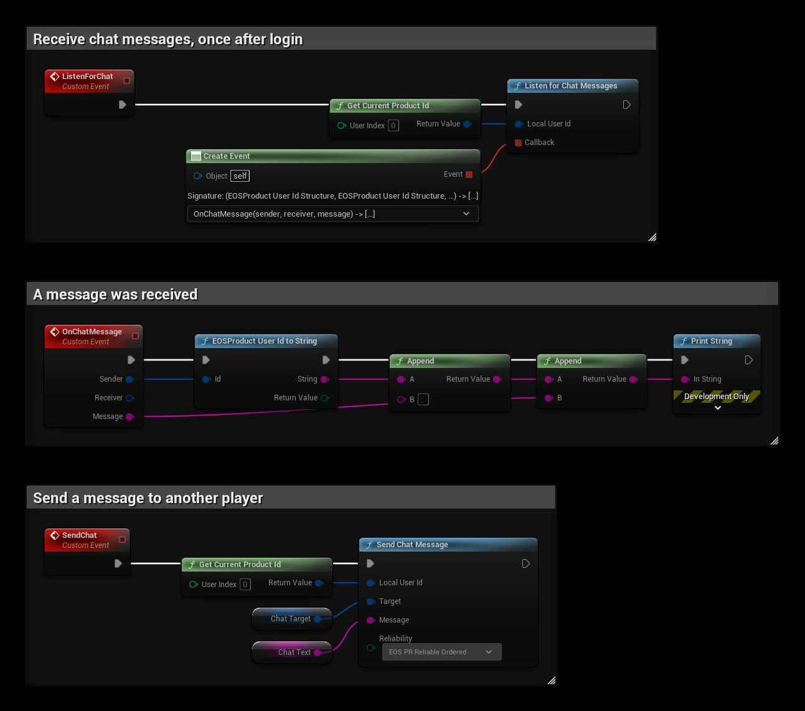

# Text Chat

EOSCore has simple text chat nodes that send messages straight to another player over [EOS P2P](./p2p.md). They don't need a server, a session or a lobby, only the Product User Id of the other player. This is an EOSCore feature, not an EOS interface, so there is no client policy setting for it.

For voice chat, see [Voice Chat](../multiplayer/voice-chat/voice-chat_rtc.md).

## Requirements
- A logged in user with a **Product User Id** (Connect login)
- The **P2P** feature allowed in your client policy

## Nodes

| Node | Use |
|---|---|
| `Listen for Chat Messages` | Starts receiving messages for a local user, and calls the callback for each message |
| `Send Chat Message` | Sends a message to another player |
| `Clear All Chat Listeners` | Stops receiving messages |

## Example

1. Call **ListenForChat** once after login. **Listen for Chat Messages** accepts chat connections from other players and calls **OnChatMessage** for every message, with the **Sender**, the **Receiver** and the **Message**. Both players must listen to receive messages.
2. The **SendChat** event sends **Chat Text** to **Chat Target**. Use **EOS PR Reliable Ordered** for chat, so messages arrive and in the right order.

## Notes
- The messages use the P2P socket `CHAT`, so they don't interfere with your own P2P traffic or the EOSCore NetDriver.
- A message is sent as one P2P packet, so keep messages short (a P2P packet holds up to 1170 bytes).
- The sender's id is a Product User Id. To show a name, look it up with the Connect or User Info interface, see [Player Name](../examples/player_name.md).
