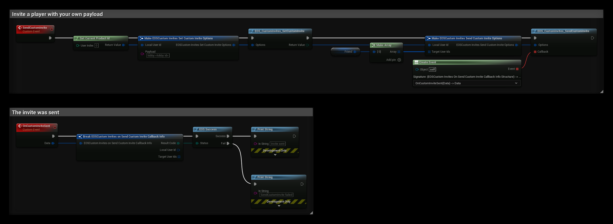
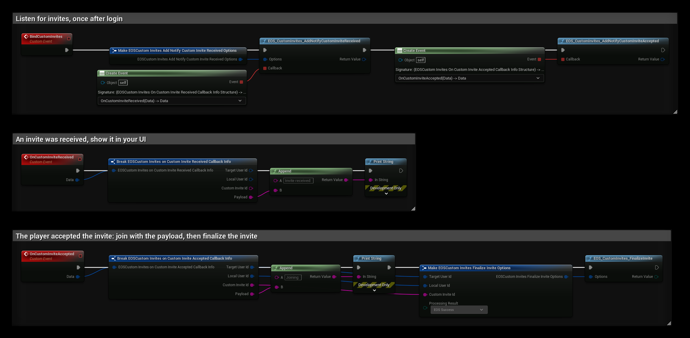

# Custom Invites

Custom Invites send an invite with your own text payload to other players, for example the id of a lobby, a party or a server address. Unlike lobby and session invites, EOS does not join anything for you: the receiver reads the payload and joins in your own code.

- [EOS Custom Invites documentation](https://dev.epicgames.com/docs/game-services/custom-invites-interface)

## Requirements
- A logged in user with a **Product User Id** (Connect login), see [Authentication](../getting_started/auth/information.md)
- The **Custom Invites** feature allowed in your client policy

## Common Nodes

| Node | Use |
|---|---|
| `EOS_CustomInvites_SetCustomInvite` | Sets the payload that the next invites carry |
| `EOS_CustomInvites_SendCustomInvite` | Sends the invite to one or more Product User Ids |
| `EOS_CustomInvites_AddNotifyCustomInviteReceived` | Called when an invite is received |
| `EOS_CustomInvites_AddNotifyCustomInviteAccepted` | Called when the player accepts an invite in the overlay or platform UI |
| `EOS_CustomInvites_AddNotifyCustomInviteRejected` | Called when the player rejects an invite |
| `EOS_CustomInvites_FinalizeInvite` | Tells EOS that you have handled an accepted invite |
| `EOS_CustomInvites_SendRequestToJoin` | Asks another player to invite you |
| `EOS_CustomInvites_AddNotifyRequestToJoinReceived` | Called when another player asks to join you |
| `EOS_CustomInvites_AcceptRequestToJoin`, `EOS_CustomInvites_RejectRequestToJoin` | Answers a request to join |
| `EOS_CustomInvites_DisableRequestToJoin` | Stops other players from sending requests to join you |

## Example

### Sending an invite

The **SendCustomInvite** event invites the player in **Friend**:

1. **EOS_CustomInvites_SetCustomInvite** sets the **Payload**. Use a format your game can read back, for example `lobby:<lobby id>`. The payload stays set, so you only need to call this again when it changes.
2. **EOS_CustomInvites_SendCustomInvite** sends the invite to every id in **Target User Ids**.
3. **OnCustomInviteSent** is called with the result.

### Receiving and accepting invites

Call **BindCustomInvites** once after login, for example from the Game Instance:

1. **OnCustomInviteReceived** is called for every invite. **Payload** is the text the sender set, and **Target User Id** is the sender. Show the invite in your UI, and join with the payload when the player accepts it there.
2. **OnCustomInviteAccepted** is called when the player accepts the invite outside your UI, for example in the EOS overlay or a console's system UI. Join with the **Payload**, then call **EOS_CustomInvites_FinalizeInvite** with the same ids and **Custom Invite Id**. Set **Processing Result** to **EOS Success** when the join worked, or to an error when it did not.

Keep the notification ids if you want to remove the notifications later with the matching `RemoveNotify` nodes.
