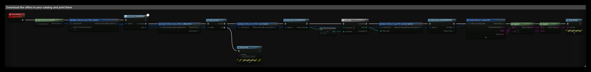
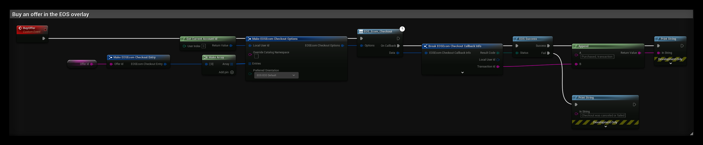
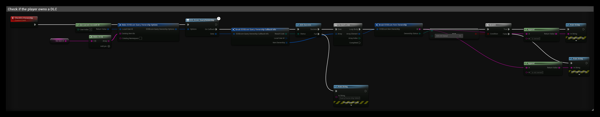

# Ecom (Epic Games Store)

The Ecom interface handles offers, purchases and entitlements for games sold on the Epic Games Store. It needs an **Epic Account** login (Auth interface), not only a Connect login.

- [EOS Ecom documentation](https://dev.epicgames.com/docs/epic-games-store/services/ecom/ecom-overview)

## Common Nodes

| Node | Use |
|---|---|
| `EOS_Ecom_QueryOffers` | Downloads the offers in your catalog |
| `EOS_Ecom_GetOfferCount` + `EOS_Ecom_CopyOfferByIndex` | Reads offers (title, price, currency) |
| `EOS_Ecom_Checkout` | Opens the purchase flow in the EOS overlay |
| `EOS_Ecom_GetTransactionCount` + `EOS_Ecom_CopyTransactionByIndex` | Reads finished transactions, release them with `EOS_Ecom_Transaction_Release` |
| `EOS_Ecom_QueryEntitlements` | Downloads what the player owns |
| `EOS_Ecom_GetEntitlementsCount` + `EOS_Ecom_CopyEntitlementByIndex` | Reads entitlements |
| `EOS_Ecom_QueryOwnership` | Checks if the player owns specific catalog items, for example DLC |
| `EOS_Ecom_RedeemEntitlements` | Marks consumable entitlements as redeemed |
| `EOS_Ecom_QueryOwnershipToken` / `EOS_Ecom_QueryEntitlementToken` | Signed tokens your backend can verify |

## Example

### Reading the offers

The **QueryOffers** event downloads the offers in your catalog and prints the title and id of each one:

1. **Get Current Account Id** gives the Epic Account Id of the logged in player. Ecom uses the Epic Account Id, not the Product User Id.
2. **EOS_Ecom_QueryOffers** downloads the offers. Leave **Override Catalog Namespace** empty to use the catalog of your sandbox.
3. When the query succeeds, **EOS_Ecom_GetOfferCount** returns the number of offers, and the **For Loop** reads each one with **EOS_Ecom_CopyOfferByIndex**. An offer has the **Id** you pass to Checkout, the **Title Text**, the **Currency Code** and the prices.

### Buying an offer

The **BuyOffer** event opens the purchase flow in the EOS overlay for the offer in **Offer Id**:

1. Make one **EOSEcom Checkout Entry** per offer and put them in **Entries**. The player can buy several offers in one checkout.
2. **EOS_Ecom_Checkout** opens the overlay and calls **On Callback** when the player closes it.
3. On **Success**, **Transaction Id** identifies the purchase. **Fail** is also called when the player cancels.

### Checking ownership of a DLC

The **CheckDLCOwnership** event checks if the player owns the catalog item in **Dlc Item Id**:

1. **EOS_Ecom_QueryOwnership** takes an array of **Catalog Item Ids**, so you can check several items in one call.
2. **Item Ownership** has one entry per item. The **For Each Loop** compares each **Ownership Status** with **EOS OS Owned**.

## Notes
- **Checkout** uses the EOS overlay, so it only works in a Standalone or packaged game started with the overlay enabled.
- Grant items from the transaction or from a fresh **QueryEntitlements**, never from the client alone. For important items, verify an ownership or entitlement token on your server.
- The `EOSCore` Online Subsystem Store/Purchase interface is only available when the game was started from the Epic Games Launcher (`-EpicPortal`).
