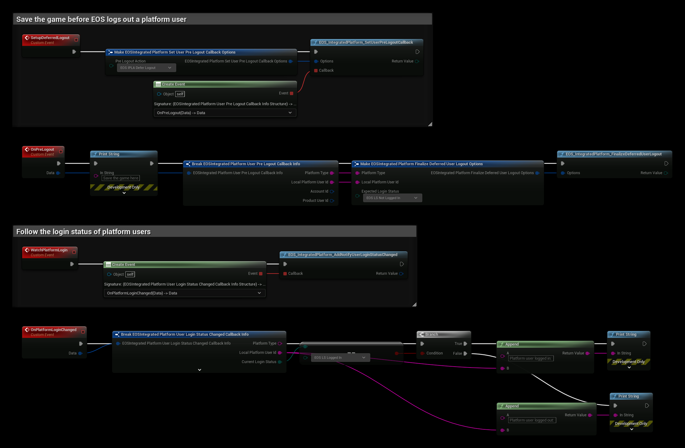

# Integrated Platform

The Integrated Platform interface links the login state of a platform account, for example Steam, to the EOS login. EOS then handles platform friends, invites and logout together with the platform.

- [EOS Integrated Platform documentation](https://dev.epicgames.com/docs/api-ref/interfaces/integrated-platform)

## Common Nodes

| Node | Use |
|---|---|
| `EOS_IntegratedPlatform_SetUserLoginStatus` | Tells EOS that a platform user logged in or out |
| `EOS_IntegratedPlatform_AddNotifyUserLoginStatusChanged` | Called when the login status of a platform user changes |
| `EOS_IntegratedPlatform_SetUserPreLogoutCallback` | Called before EOS logs out a user because the platform user logged out |
| `EOS_IntegratedPlatform_ClearUserPreLogoutCallback` | Removes the pre-logout callback |
| `EOS_IntegratedPlatform_FinalizeDeferredUserLogout` | Finishes a logout that you deferred in the pre-logout callback |

**Platform Type** defaults to `STEAM`. **Local Platform User Id** is the user id on that platform, for example the Steam Id as a string.

## Deferring a logout
The **Pre Logout Action** in the options of **EOS_IntegratedPlatform_SetUserPreLogoutCallback** decides what happens when the platform user logs out:

- **Process Logout Immediately**: EOS logs out the user right away.
- **Defer Logout**: EOS waits, so you can save the game first. Then call **EOS_IntegratedPlatform_FinalizeDeferredUserLogout** with the **Expected Login Status** (usually **Not Logged In**).

:::note
The platform must be registered when the EOS platform is created. For Steam, turn on **Enable Steam Integrated Platform** in Project Settings, see [Steam Integrated Platform](../settings_reference.md#steam-integrated-platform). Without it these nodes return an error such as **EOS_NotConfigured**.
:::

## Example

1. **SetupDeferredLogout** calls **EOS_IntegratedPlatform_SetUserPreLogoutCallback** with **Pre Logout Action** set to **EOS IPLA Defer Logout**. Call it once after the EOS platform is created.
2. When the platform user logs out, **OnPreLogout** is called. Save the game where the example prints *Save the game here*, then call **EOS_IntegratedPlatform_FinalizeDeferredUserLogout** with the same **Platform Type** and **Local Platform User Id**, and **Expected Login Status** set to **EOS LS Not Logged In**. If the save is asynchronous, call Finalize when it completes.
3. **WatchPlatformLogin** binds **EOS_IntegratedPlatform_AddNotifyUserLoginStatusChanged**. **OnPlatformLoginChanged** checks the **Current Login Status** and prints whether the platform user logged in or out.
