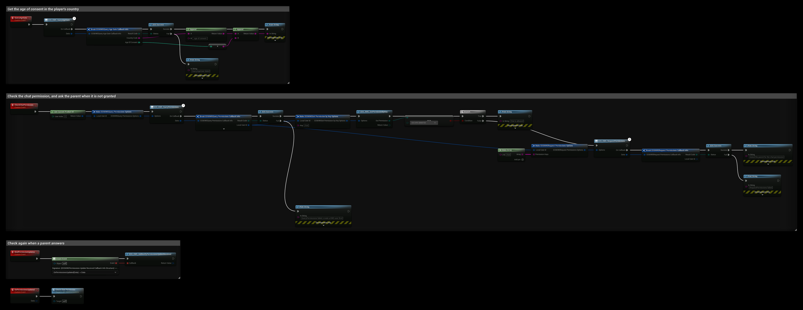

# Kids Web Services (KWS)

The KWS interface handles age gates and parental consent through Epic's Kids Web Services. Use it when your game has players under the age of consent in their country, and you need a parent's permission before you turn on features such as chat or voice.

- [EOS KWS documentation](https://dev.epicgames.com/docs/kids-web-services/kws-overview)

## Requirements
- KWS must be enabled for your product in the Developer Portal, with the permissions your game uses.
- The player must be logged in with the **Connect** interface. KWS uses the **Product User Id**.

## Common Nodes

| Node | Use |
|---|---|
| `EOS_KWS_QueryAgeGate` | Downloads the player's country and the age of consent there |
| `EOS_KWS_CreateUser` | Creates a KWS user with a date of birth and, for minors, the parent's email |
| `EOS_KWS_QueryPermissions` | Downloads the permissions and the minor status of the player |
| `EOS_KWS_GetPermissionsCount` + `EOS_KWS_CopyPermissionByIndex` | Reads the downloaded permissions |
| `EOS_KWS_GetPermissionByKey` | Reads the status of one permission, for example `chat` |
| `EOS_KWS_RequestPermissions` | Asks the parent for one or more permissions (at most 16 per request) |
| `EOS_KWS_UpdateParentEmail` | Changes the parent's email, the consent request is sent again |
| `EOS_KWS_AddNotifyPermissionsUpdateReceived` | Called when a parent grants or rejects a permission |

The async nodes (`QueryAgeGate`, `CreateUser`, `QueryPermissions`, `RequestPermissions` and `UpdateParentEmail`) are under **EOSCore > KWS > Async** and have an **On Callback** pin.

## Typical Flow
1. Call **EOS_KWS_QueryAgeGate** to get the **Age Of Consent** for the player's country, then ask the player for their date of birth.
2. Call **EOS_KWS_QueryPermissions**. If the player has no KWS user yet, call **EOS_KWS_CreateUser** with the **Date Of Birth** (`YYYY-MM-DD`) and, for minors, the **Parent Email**.
3. Check each feature with **EOS_KWS_GetPermissionByKey**. The status is **Granted**, **Rejected** or **Pending**.
4. For permissions that are not granted, call **EOS_KWS_RequestPermissions** with the **Permission Keys**. The parent gets an email.
5. Bind **EOS_KWS_AddNotifyPermissionsUpdateReceived** to turn the feature on when the parent answers, then query the permissions again.

:::note
KWS only gives you the permission status. Your game must turn the feature off itself while a permission is not granted.
:::

## Example

1. **QueryAgeGate** prints the player's **Country Code** and the **Age Of Consent** there. Use it to decide if you must ask for the date of birth.
2. **CheckChatPermission** downloads the permissions with **EOS_KWS_QueryPermissions**, then reads `chat` with **EOS_KWS_GetPermissionByKey**. If the status is **EOS KPS GRANTED**, chat is allowed. Otherwise **EOS_KWS_RequestPermissions** asks the parent for `chat`. If QueryPermissions fails because the player has no KWS user yet, call **EOS_KWS_CreateUser** first.
3. **BindPermissionUpdates** binds **EOS_KWS_AddNotifyPermissionsUpdateReceived** once after login. **OnPermissionsUpdated** runs **CheckChatPermission** again when the parent answers.

A status of **EOS KPS PENDING** means a request was already sent and the parent hasn't answered. You can skip a new request in that case, so the parent doesn't get another email.
