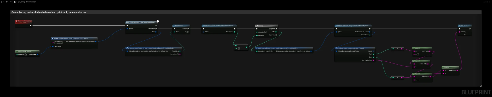

# Leaderboards

:::info Video Tutorial is available
[Leaderboards video](../videos/leaderboards.mdx)
:::

A leaderboard ranks players by one [Stat](./stats.md). Create it in the Developer Portal (**Game Services > Leaderboards**) and pick the stat and the sort order. You never write to a leaderboard directly: ingest the stat and the leaderboard updates.

- [EOS Leaderboards documentation](https://dev.epicgames.com/docs/epic-online-services/player-and-game-data/leaderboards-interface)

## Common Nodes

| Node | Use |
|---|---|
| `EOS_Leaderboards_QueryLeaderboardDefinitions` | Downloads the leaderboard definitions |
| `EOS_Leaderboards_GetLeaderboardDefinitionCount` + `EOS_Leaderboards_CopyLeaderboardDefinitionByIndex` | Reads the definitions |
| `EOS_Leaderboards_QueryLeaderboardRanks` | Downloads the top ranks of a leaderboard |
| `EOS_Leaderboards_GetLeaderboardRecordCount` + `EOS_Leaderboards_CopyLeaderboardRecordByIndex` | Reads the ranks (rank, score, user id, display name) |
| `EOS_Leaderboards_CopyLeaderboardRecordByUserId` | Finds one player in the downloaded ranks |
| `EOS_Leaderboards_QueryLeaderboardUserScores` | Downloads the scores of specific players, for example friends |
| `EOS_Leaderboards_GetLeaderboardUserScoreCount` + `EOS_Leaderboards_CopyLeaderboardUserScoreByIndex` | Reads those scores |

## Typical Flow
1. Ingest the stat with `EOS_Stats_IngestStat` when the match ends.
2. Call **QueryLeaderboardRanks** with the leaderboard id.
3. Loop over **GetLeaderboardRecordCount** and **CopyLeaderboardRecordByIndex** to fill your UI.

## Example

The **QueryLeaderboard** event downloads the top ranks of the `HIGHSCORE` leaderboard and prints them as `1. PlayerName - 1500`:

1. **EOS_Leaderboards_QueryLeaderboardRanks** downloads the ranks. **Leaderboard Id** is the id from the Developer Portal.
2. When the query succeeds, **EOS_Leaderboards_GetLeaderboardRecordCount** returns the number of downloaded records.
3. The **For Loop** reads each record with **EOS_Leaderboards_CopyLeaderboardRecordByIndex**. A record has the **Rank**, **Score**, **User Id** and **User Display Name** of a player.

:::tip
A leaderboard only changes when its stat is ingested, see [Stats](./stats.md). The new score can take a short while to show up in the ranks.
:::

## Online Subsystem
The `EOSCore` Online Subsystem also implements `IOnlineLeaderboards`, so the engine's **Read Leaderboard Integer** and **Write Leaderboard Integer** nodes work as well.
