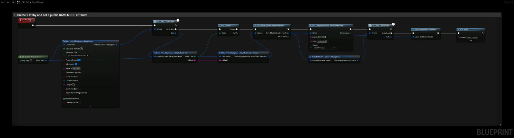
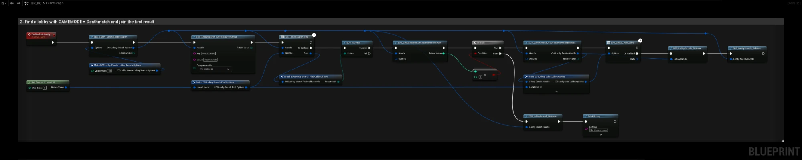
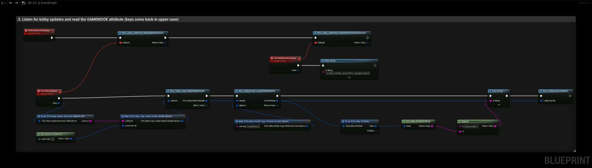
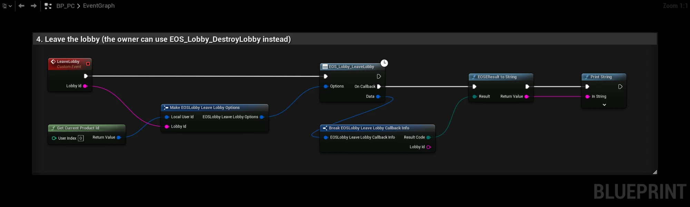

# Lobby

A lobby is a group of players that share attributes and can talk with voice (RTC) before or during a match. Lobbies are separate from [game sessions](../multiplayer/creating-session.md): a common setup is to gather players in a lobby, then move them to a game session, see [Lobby to Session](../multiplayer/lobby-to-session.md).

- [EOS Lobbies documentation](https://dev.epicgames.com/docs/game-services/lobbies)

## Requirements
- A logged in user with a **Product User Id** (Connect login)
- The **Lobbies** feature allowed in your client policy
- **Enable RTC** in [Project Settings](../settings_reference.md) if you use lobby voice

## Creating and Joining

| Node | Use |
|---|---|
| `EOS_Lobby_CreateLobby` | Creates a lobby, you become the owner. Options include max members, permission level, presence, RTC room and host migration |
| `EOS_Lobby_CreateLobbySearch` | Creates a search handle |
| `EOS_LobbySearch_SetParameterString` / `Bool` / `Int64` / `Double`, `EOS_LobbySearch_SetLobbyId`, `EOS_LobbySearch_SetTargetUserId` | Search filters |
| `EOS_LobbySearch_Find` | Runs the search |
| `EOS_LobbySearch_GetSearchResultCount` + `EOS_LobbySearch_CopySearchResultByIndex` | Gets a lobby details handle per result |
| `EOS_Lobby_JoinLobby` / `EOS_Lobby_JoinLobbyById` | Joins with a details handle or by lobby id |
| `EOS_Lobby_LeaveLobby` / `EOS_Lobby_DestroyLobby` | Leaves, or (owner) destroys the lobby |

Release every details handle (`EOS_LobbyDetails_Release`) and search handle (`EOS_LobbySearch_Release`) when you are done with it.

## Attributes

| Node | Use |
|---|---|
| `EOS_Lobby_UpdateLobbyModification` | Creates a modification handle (owner for lobby attributes, any member for member attributes) |
| `EOS_LobbyModification_AddAttribute*`, `EOS_LobbyModification_AddMemberAttribute*`, `EOS_LobbyModification_RemoveAttribute` | Changes attributes |
| `EOS_LobbyModification_SetMaxMembers`, `SetPermissionLevel`, `SetInvitesAllowed`, `SetBucketId` | Changes lobby settings |
| `EOS_Lobby_UpdateLobby` | Sends the modification |
| `EOS_LobbyDetails_CopyAttributeByKey`, `EOS_LobbyDetails_CopyMemberAttributeByKey` | Reads attributes |
| `Get Lobby Attribute String` / `Int64` / `Double` | Reads the value of an attribute you copied |

:::caution
EOS stores attribute keys in upper case. A key added as `GameMode` comes back as `GAMEMODE`, so use upper case keys everywhere, in searches and in `CopyAttributeByKey`.
:::

## Notifications
Bind these once, for example in the Game Instance:
- `EOS_Lobby_AddNotifyLobbyUpdateReceived`: lobby attributes changed
- `EOS_Lobby_AddNotifyLobbyMemberUpdateReceived`: a member's attributes changed
- `EOS_Lobby_AddNotifyLobbyMemberStatusReceived`: a member joined, left, was kicked or promoted, or the lobby closed
- `EOS_Lobby_AddNotifyLobbyInviteReceived` / `EOS_Lobby_AddNotifyLobbyInviteAccepted`: invites
- `EOS_Lobby_AddNotifyJoinLobbyAccepted`: the player pressed **Join** in the social overlay, see [Join Friends Lobby](../multiplayer/friends/join-friend-lobby.md)

## Owner Actions
`EOS_Lobby_KickMember`, `EOS_Lobby_PromoteMember` and `EOS_Lobby_HardMuteMember` are only allowed for the lobby owner. If host migration is enabled, EOS picks a new owner when the owner leaves.

## Voice
With **bEnableRTCRoom** set when creating the lobby, every member joins the lobby's voice room automatically. Use `EOS_Lobby_GetRTCRoomName` to get the room for the RTC Audio nodes (mute, volume) and `EOS_Lobby_AddNotifyRTCRoomConnectionChanged` to see when voice connects.

## Example

### 1. Creating a lobby

The **CreateLobby** event creates a public lobby for 4 players and adds a `GAMEMODE` attribute that other players can search for:

1. **EOS_Lobby_CreateLobby** creates the lobby. **Permission Level** `EOS_LPL_PUBLICADVERTISED` makes it visible in searches. **Bucket Id** groups lobbies, for example per game mode or region.
2. When the lobby is created, **EOS_Lobby_UpdateLobbyModification** opens a modification handle for the new **Lobby Id**.
3. **EOS_LobbyModification_AddAttributeString** adds `GAMEMODE = Deathmatch` with public visibility.
4. **EOS_Lobby_UpdateLobby** sends the change. Release the handle with **EOS_LobbyModification_Release** when it is done.

You can add several attributes to the same modification before you call UpdateLobby.

### 2. Finding and joining a lobby

The **FindAndJoinLobby** event searches for a Deathmatch lobby and joins the first result:

1. **EOS_Lobby_CreateLobbySearch** creates a search handle for up to 10 results.
2. **EOS_LobbySearch_SetParameterString** filters on `GAMEMODE` equal to `Deathmatch`.
3. **EOS_LobbySearch_Find** runs the search. **EOS_LobbySearch_GetSearchResultCount** returns how many lobbies were found.
4. If at least one lobby was found, **EOS_LobbySearch_CopySearchResultByIndex** gives a lobby details handle for the first one and **EOS_Lobby_JoinLobby** joins it.
5. Release the details handle and the search handle when you are done with them, also when nothing was found.

### 3. Listening for changes

Call **BindLobbyNotifications** once, for example from the Game Instance:

- **OnLobbyMemberStatus** runs when a member joins, leaves, is kicked or promoted, or when the lobby is closed. **Current Status** says which.
- **OnLobbyUpdated** runs when the owner changes the lobby. The example copies a lobby details handle for the **Lobby Id**, reads the `GAMEMODE` attribute with **EOS_LobbyDetails_CopyAttributeByKey** and **Get Lobby Attribute String**, and releases the handle again.

### 4. Leaving the lobby

The **LeaveLobby** event leaves the lobby with the given **Lobby Id**. The owner can use **EOS_Lobby_DestroyLobby** instead, which closes the lobby for all members.

:::note
If the owner destroys the lobby while you are leaving, **EOS_Lobby_LeaveLobby** returns `EOS_NotFound`. The lobby is already gone, so treat it as a successful leave.
:::
