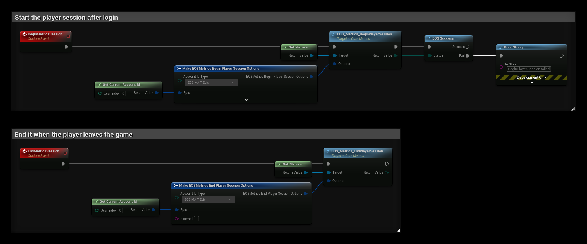

# Metrics

The Metrics interface records when a player starts and stops playing. EOS uses it for the player and session statistics in the Developer Portal, such as daily active users and play time.

- [EOS Metrics documentation](https://dev.epicgames.com/docs/game-services/eos-metrics-interface)

## Common Nodes

| Node | Use |
|---|---|
| `EOS_Metrics_BeginPlayerSession` | The player started playing |
| `EOS_Metrics_EndPlayerSession` | The player stopped playing |

## Example

1. Call **BeginMetricsSession** after login. **Account Id Type** says which id identifies the player: **EOS MAIT Epic** uses the Epic Account Id in **Epic**, and **EOS MAIT External** uses the text in **External**, for example a Steam id or a DeviceId login.
2. **Display Name** is the name shown for the player. **Controller Type**, **Server Ip** and **Game Session Id** are optional and let you split the statistics by input device and game session.
3. Call **EndMetricsSession** with the same **Account Id Type** and id when the player leaves the game or logs out.

:::tip
Begin a new player session for every login, and always end it, also when the player returns to the main menu and logs in with another account.
:::
