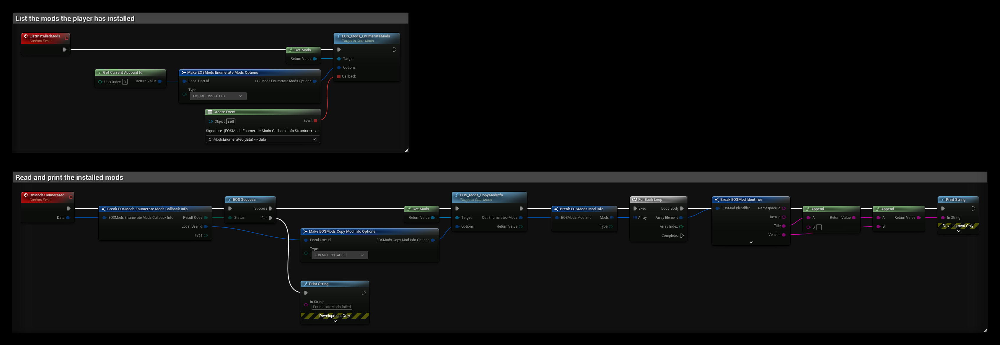

# Mods

The Mods interface lists, installs, updates and uninstalls mods that are published for your game on the Epic Games Store. It needs an **Epic Account** login (Auth interface), and the game must be started from the Epic Games Launcher, which installs the mods.

- [EOS Mods documentation](https://dev.epicgames.com/docs/epic-games-store/services/mods)

## Common Nodes

| Node | Use |
|---|---|
| `EOS_Mods_EnumerateMods` | Downloads the list of installed mods, or of all mods available to the player |
| `EOS_Mods_CopyModInfo` | Reads the list from the last EnumerateMods |
| `EOS_Mods_InstallMod` | Installs a mod |
| `EOS_Mods_UpdateMod` | Updates an installed mod |
| `EOS_Mods_UninstallMod` | Uninstalls a mod |

The Mods nodes need a target: connect **Get Mods**.

## Example

1. The **ListInstalledMods** event calls **EOS_Mods_EnumerateMods** with **Type** set to **EOS MET INSTALLED**. Use **EOS MET ALL AVAILABLE** to list every mod the player can install.
2. **OnModsEnumerated** is called when the list is ready. **EOS_Mods_CopyModInfo** reads it, with the same **Type**.
3. The **For Each Loop** prints the **Title** and **Version** of each mod. Pass the whole **EOSMod Identifier** to **InstallMod**, **UpdateMod** or **UninstallMod**.
