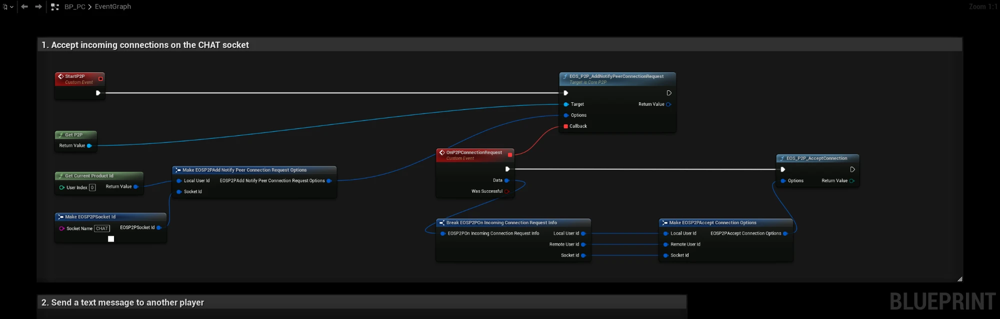
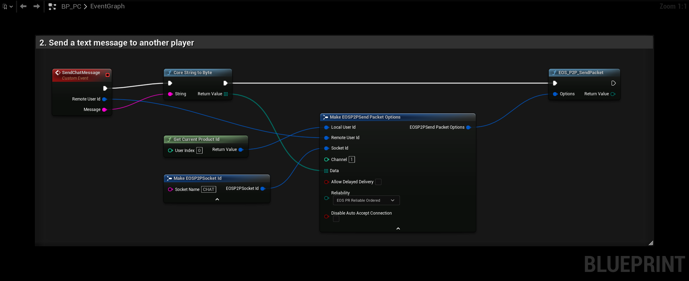
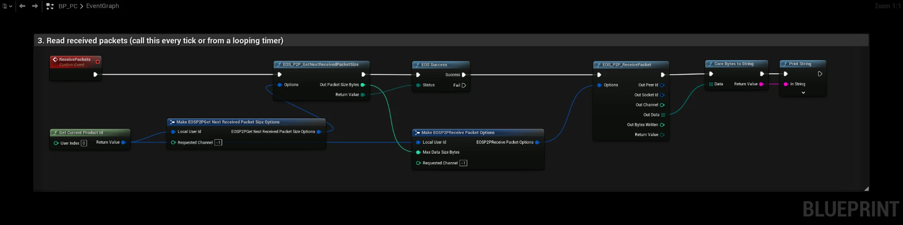

# P2P

The P2P interface sends packets directly between players, with NAT traversal and Epic relay servers when a direct connection is not possible. Players are addressed by their **Product User Id**, no IP addresses or open ports are needed.

- [EOS P2P documentation](https://dev.epicgames.com/docs/game-services/p-2-p)

:::tip
For normal Unreal replication you don't need these nodes. The EOSCore NetDriver uses P2P for you, see [Configuring Online Subsystem](../getting_started/configuring_subsystem.md). Use the P2P nodes for your own messages, for example chat or a lobby handshake.
:::

## Common Nodes

| Node | Use |
|---|---|
| `EOS_P2P_SendPacket` | Sends data to a remote user on a socket name and channel. The first packet opens the connection |
| `EOS_P2P_AddNotifyPeerConnectionRequest` | Called when a remote user wants to connect |
| `EOS_P2P_AcceptConnection` | Accepts the connection (call it for incoming requests, or before you send to open both ways) |
| `EOS_P2P_GetNextReceivedPacketSize` + `EOS_P2P_ReceivePacket` | Reads received packets, call it every tick |
| `EOS_P2P_CloseConnection` / `EOS_P2P_CloseConnections` | Closes one or all connections on a socket |
| `EOS_P2P_AddNotifyPeerConnectionEstablished` / `Interrupted` / `Closed` | Connection state changes |

## Settings

| Node | Use |
|---|---|
| `EOS_P2P_QueryNATType` + `EOS_P2P_GetNATType` | Finds the local NAT type |
| `EOS_P2P_SetRelayControl` / `EOS_P2P_GetRelayControl` | Allows, forces or forbids relay servers. Forcing relays hides player IP addresses from each other |
| `EOS_P2P_SetPortRange` / `EOS_P2P_GetPortRange` | Limits the local UDP ports |
| `EOS_P2P_SetPacketQueueSize` + `EOS_P2P_AddNotifyIncomingPacketQueueFull` | Limits the packet queues |
| `EOS_P2P_ClearPacketQueue` | Drops the queued outgoing packets to one user on a socket |

## Example
The example sends text messages between two players on a socket named `CHAT`. Both players run the same Blueprint.

### 1. Accepting connections

Call **StartP2P** once after login. **EOS_P2P_AddNotifyPeerConnectionRequest** calls **OnP2PConnectionRequest** when another player sends the first packet on the `CHAT` socket. The event accepts the connection with **EOS_P2P_AcceptConnection**, using the user ids and socket from the request.

### 2. Sending a message

**SendChatMessage** takes the **Remote User Id** of the other player and the text to send. **Core String To Byte** turns the text into bytes and **EOS_P2P_SendPacket** sends them on channel 1 with **Reliability** `EOS_PR_ReliableOrdered`, so messages arrive and arrive in order. Channels go from 0 to 255, the default is 0. They let you keep different kinds of messages apart on the same socket.

The remote user id is the Product User Id of the other player, for example from a lobby member or a session.

### 3. Receiving messages

Packets are queued until you read them, so call **ReceivePackets** every tick or from a looping timer:

1. **EOS_P2P_GetNextReceivedPacketSize** returns `EOS_Success` and the size when a packet is waiting, and `EOS_NotFound` when the queue is empty. **Requested Channel** `-1` reads from any channel, set it to a channel number to read only that channel.
2. **EOS_P2P_ReceivePacket** reads the packet. **Max Data Size Bytes** is the size from step 1.
3. **Core Bytes To String** turns the data back into text. **Out Peer Id** says who sent it.

To read every waiting packet in one tick, repeat the two calls until GetNextReceivedPacketSize no longer returns `EOS_Success`.
