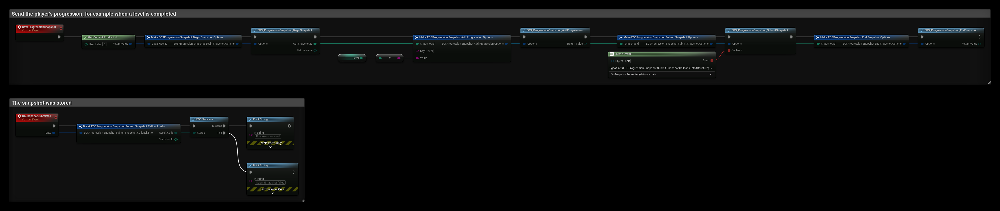

# Progression Snapshot

The Progression Snapshot interface stores a snapshot of a player's progression on the EOS backend, as a list of key/value text pairs, for example the player's level, character and chapter. EOS uses the snapshots when a player merges several Epic accounts into one: the player sees the progression of each account and picks the one to keep.

- [EOS Progression Snapshot documentation](https://dev.epicgames.com/docs/epic-account-services/progression-snapshot)

## Requirements
- A logged in user with a **Product User Id** (Connect login)

## Common Nodes

| Node | Use |
|---|---|
| `EOS_ProgressionSnapshot_BeginSnapshot` | Starts a new snapshot and returns its **Snapshot Id** |
| `EOS_ProgressionSnapshot_AddProgression` | Adds one key/value pair to the snapshot |
| `EOS_ProgressionSnapshot_SubmitSnapshot` | Sends the snapshot to the backend |
| `EOS_ProgressionSnapshot_EndSnapshot` | Frees the local snapshot |
| `EOS_ProgressionSnapshot_DeleteSnapshot` | Deletes the stored snapshots of the player |

## Example

The **SaveProgressionSnapshot** event stores the player's level:

1. **EOS_ProgressionSnapshot_BeginSnapshot** starts a snapshot for the Product User Id and returns the **Out Snapshot Id** the other nodes use.
2. **EOS_ProgressionSnapshot_AddProgression** adds `level` with the value of **Level**. Call it once for every key. Keys and values are text, so convert numbers to strings.
3. **EOS_ProgressionSnapshot_SubmitSnapshot** sends all pairs, and **OnSnapshotSubmitted** is called with the result.
4. **EOS_ProgressionSnapshot_EndSnapshot** frees the snapshot. You can call it right after Submit.

A new snapshot replaces the previous one, so always add all keys, not only the ones that changed.
