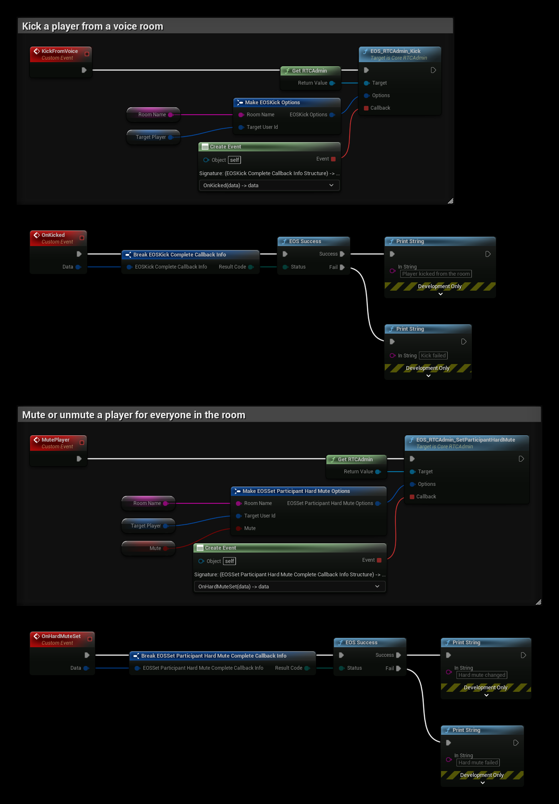

# Voice Moderation (RTC Admin)

The RTC Admin interface lets a trusted server moderate EOS voice rooms. It can kick a player from a room, mute a player for everyone in the room, and create the tokens players use to join rooms.

To set up voice rooms with your own server, see [Voice Chat (RTC/EOS Voice)](../multiplayer/voice-chat/voice-chat_rtc.md).

- [EOS Voice documentation](https://dev.epicgames.com/docs/epic-online-services/multiplayer/voice-and-rtc-interface/voice-interface)

## Requirements
- A client with a **Trusted Server** policy that allows the voice features, see [Voice Server Credentials](../multiplayer/voice-chat/voice-chat_rtc.md#voice-server-credentials). Use it in a separate EOS configuration for your server, see [Project Settings](../settings_reference.md#eos-configurations). Don't ship it with the game client.
- **Enable RTC** turned on in the configuration

## Nodes

| Node | Use |
|---|---|
| `EOS_RTCAdmin_QueryJoinRoomToken` | Creates tokens for players to join a room |
| `EOS_RTCAdmin_CopyUserTokenByIndex`, `EOS_RTCAdmin_CopyUserTokenByUserId` | Read the tokens inside the QueryJoinRoomToken callback |
| `EOS_RTCAdmin_Kick` | Removes a player from a room and revokes their token |
| `EOS_RTCAdmin_SetParticipantHardMute` | Mutes or unmutes a player for everyone in the room |

The RTC Admin nodes need a target: connect **Get RTCAdmin**.

## Example

The example uses the variables **Room Name**, the voice room, and **Target Player**, the Product User Id of the player.

1. **KickFromVoice** calls **EOS_RTCAdmin_Kick**. The player leaves the room and can't join it again with the same token. **OnKicked** is called with the result.
2. **MutePlayer** calls **EOS_RTCAdmin_SetParticipantHardMute** with **Mute**. True mutes the player and false unmutes them. **OnHardMuteSet** is called with the result.

A hard mute is different from a local mute: no other player in the room hears the muted player, and the player can't unmute themselves. To let each player mute others only for themselves, use the RTC Audio nodes in the game client instead.

## Notes
- To send data between the players in a room, see [RTC Data](./rtc-data.md).
