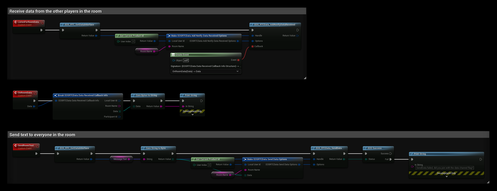

# RTC Data

RTC Data sends small binary messages to the other players in an RTC room, the same room that is used for voice. Use it for data that belongs with the voice chat, for example who is talking in a squad or push-to-talk state.

- [EOS RTC Data documentation](https://dev.epicgames.com/docs/epic-online-services/multiplayer/voice-and-rtc-interface/rtc-data-interface)

## Requirements
- Join the room with the data channel enabled: add the flag `4` (`EOS_RTC_JOINROOMFLAGS_ENABLE_DATACHANNEL`) to the **Flags** of **EOS_RTC_JoinRoom**. Lobby rooms with RTC turned on also accept the flag in the lobby's RTC options.
- See [Voice Chat (RTC)](../multiplayer/voice-chat/voice-chat_rtc.md) for how rooms and voice credentials work.

## Common Nodes

| Node | Use |
|---|---|
| `EOS_RTC_GetDataInterface` | Returns the RTC Data handle that the other nodes take |
| `EOS_RTCData_SendData` | Sends a message to everyone in the room |
| `EOS_RTCData_AddNotifyDataReceived` | Called for each message from another player |
| `EOS_RTCData_UpdateSending` | Turns sending on or off for the local player |
| `EOS_RTCData_UpdateReceiving` | Turns receiving on or off, for all players or one **Participant Id** |
| `EOS_RTCData_AddNotifyParticipantUpdated` | Called when a participant's data status changes |
| `EOS_RTC_AddNotifyRoomBeforeJoin` | Called just before the local player joins a room, for example to bind the data notifications early |

The data is a **Byte** array. **Core String To Byte** and **Core Bytes To String** convert text, other data you convert yourself. A message can be at most 1170 bytes.

## Example

The example uses the variables **Room Name**, the RTC room the player has joined, and **Message Text**.

1. **ListenForRoomData** gets the handle with **EOS_RTC_GetDataInterface** and binds **EOS_RTCData_AddNotifyDataReceived** for the room. **OnRoomData** turns the received bytes into text and prints it. **Participant Id** in the callback info is the sender.
2. **SendRoomText** turns **Message Text** into bytes and sends them with **EOS_RTCData_SendData** to everyone in the room. It fails if the room was joined without the data channel flag.

Bind the notification after joining the room, or from **EOS_RTC_AddNotifyRoomBeforeJoin** so you don't miss the first messages.
