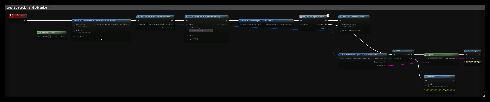
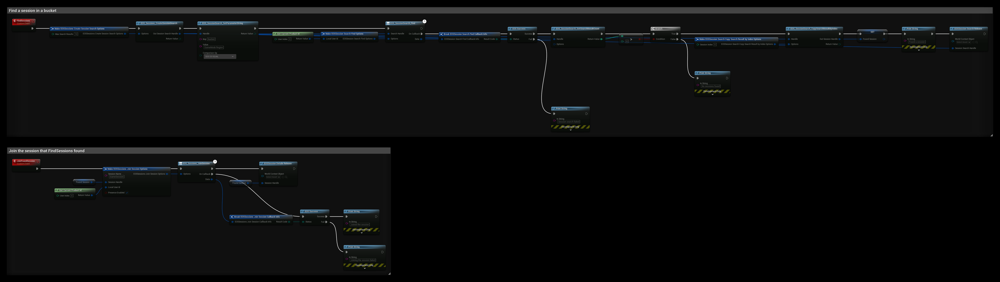

# Sessions

The Sessions interface creates, finds and joins EOS sessions directly. A session is an entry on the EOS backend that describes a game: its settings, its attributes and the players in it. Players find it with a search and join it, then connect to the game server or host themselves.

For most games, the Online Subsystem nodes in [Creating a Session](../multiplayer/creating-session.md) and [Finding a Session](../multiplayer/finding-session.md) are simpler, since they also travel to the server. Use the Sessions interface when you need full control, for example to manage sessions from your own server code.

- [EOS Sessions documentation](https://dev.epicgames.com/docs/epic-online-services/multiplayer/lobbies-and-sessions/sessions-interface/sessions-intro)

## Requirements
- A logged in user with a **Product User Id** (Connect login), see [Authentication](../getting_started/auth/information.md)
- The **Sessions** feature allowed in your client policy

## Common Nodes

| Node | Use |
|---|---|
| `EOS_Sessions_CreateSessionModification` | Starts the settings of a new session and returns a modification handle |
| `EOS_Sessions_UpdateSessionModification` | Starts changes to a session you already created |
| `EOS_SessionModification_AddAttributeString` (also `Bool`, `Int64`, `Double`) | Adds an attribute that searches can filter on |
| `EOS_SessionModification_SetHostAddress` | Sets the address players connect to |
| `EOS_Sessions_UpdateSession` | Creates or updates the session on the backend |
| `EOS_Sessions_CreateSessionSearch` | Starts a search and returns a search handle |
| `EOS_SessionSearch_SetParameterString` (also `Bool`, `Int64`, `Double`) | Adds a filter to the search |
| `EOS_SessionSearch_Find` | Runs the search |
| `EOS_SessionSearch_GetSearchResultCount`, `EOS_SessionSearch_CopySearchResultByIndex` | Read the results as session details handles |
| `EOS_SessionDetails_CopyInfo` | Reads the id, host address and settings of a result |
| `EOS_Sessions_JoinSession` | Joins a session from a search result or an invite |
| `EOS_Sessions_StartSession`, `EOS_Sessions_EndSession` | Marks the game as started or ended |
| `EOS_Sessions_RegisterPlayers`, `EOS_Sessions_UnregisterPlayers` | The owner adds or removes players that connected or left |
| `EOS_Sessions_DestroySession` | Removes the session |

## Example

### Creating a session

The **CreateSession** event:

1. **EOS_Sessions_CreateSessionModification** starts a session with the settings in the options:
   - **Session Name** is a local name for the session. The other Sessions nodes, like Start, End and Destroy, use it to find the session.
   - **Bucket Id** groups sessions, for example by game mode and region. Searches must filter on a bucket.
   - **Max Players** is the number of players that can join.
   - **Presence Enabled** shows the session in the player's presence, so friends can join it. Only one session per player can have presence.
2. **EOS_SessionModification_AddAttributeString** adds a `MAP` attribute. **EOS SAAT Advertise** makes it visible in searches. Int64 and Double values are passed as text.
3. **EOS_Sessions_UpdateSession** creates the session on the backend. The modification handle is copied when the node runs, so **EOSSession Modification Release** frees it right away.
4. **OnCallback** returns the **Session Id** of the new session.

When your game starts, call **EOS_Sessions_StartSession**. If **Join In Progress Allowed** is off, players can no longer join after that.

### Finding and joining a session

**FindSessions**:

1. **EOS_Sessions_CreateSessionSearch** starts a search for at most **Max Search Results** sessions.
2. **EOS_SessionSearch_SetParameterString** filters on the bucket. The key `bucket` matches the **Bucket Id** the session was created with. Add more parameters to filter on your own attributes, like `MAP`.
3. **EOS_SessionSearch_Find** runs the search. When it succeeds, **EOS_SessionSearch_GetSearchResultCount** returns the number of results.
4. **EOS_SessionSearch_CopySearchResultByIndex** copies the first result to the **Found Session** variable. To list all results, loop from 0 to the count minus 1, and read each result with **EOS_SessionDetails_CopyInfo**.
5. **EOSSession Search Release** frees the search. The session details handles you copied stay valid.

**JoinFoundSession**:

1. **EOS_Sessions_JoinSession** joins the session in **Found Session** under the local **Session Name**.
2. **EOSSession Details Release** frees the details handle when you don't need it anymore.
3. When the join succeeds, connect to the **Host Address** from the session details. Joining a session does not connect you to the game.

:::tip
Every handle the Sessions nodes return must be released with the matching `Release` node: modification, search, session details and active session handles. Unreleased handles keep their memory until the game exits.
:::
