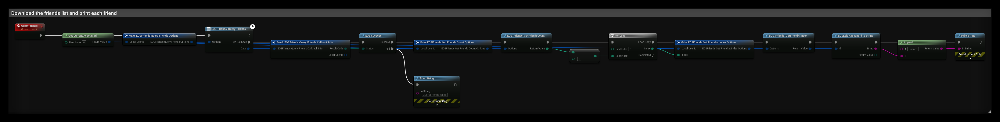
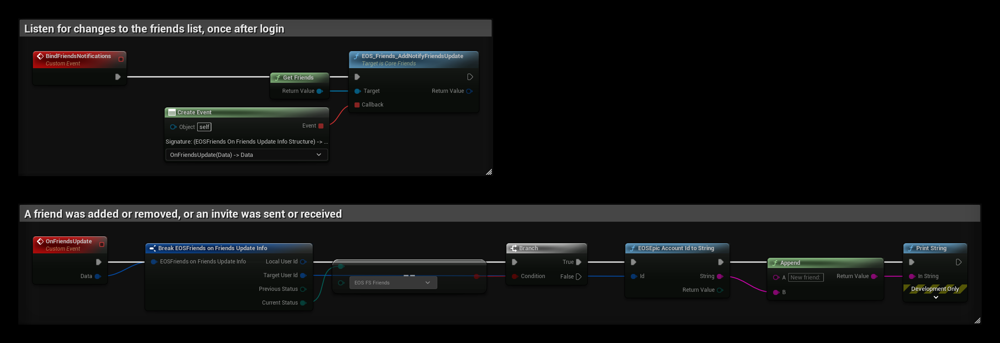
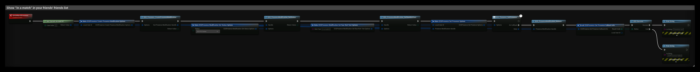

# Friends, Presence and User Info

These interfaces use **Epic Account Services** and need an Epic Account login (Auth interface) with the matching permissions (scopes), see [Scope Consent](../getting_started/setup_client_policy.md#scope-consent).

- [EOS Friends documentation](https://dev.epicgames.com/docs/epic-online-services/accounts-and-social/eos-friends-interface)
- [EOS Presence documentation](https://dev.epicgames.com/docs/epic-online-services/accounts-and-social/eos-presence-interface)
- [EOS User Info documentation](https://dev.epicgames.com/docs/epic-online-services/accounts-and-social/eos-user-info-interface)

:::note
The `EOSCore` Online Subsystem also implements `IOnlineFriends`, `IOnlinePresence`, `IOnlineUser` and parts of `IOnlineExternalUI` (login, friends overlay, web URL), so C++ code and plugins that use the Online Subsystem can use them as well. In Blueprints, use the EOSCore nodes below. See [Supported Platforms and Features](../supported_platforms.md#online-subsystem-interfaces).
:::

## Friends

| Node | Use |
|---|---|
| `EOS_Friends_QueryFriends` | Downloads the friends list (needs the Friends List scope) |
| `EOS_Friends_GetFriendsCount` + `EOS_Friends_GetFriendAtIndex` | Reads the friends' Epic Account Ids |
| `EOS_Friends_GetStatus` | Friend, invite sent, invite received or not friends |
| `EOS_Friends_SendInvite`, `EOS_Friends_AcceptInvite`, `EOS_Friends_RejectInvite` | Friend invites |
| `EOS_Friends_AddNotifyFriendsUpdate` | Called when the friends list changes |

### Example: reading the friends list

The **QueryFriends** event downloads the friends list of the local player and prints each friend:

1. **EOS_Friends_QueryFriends** downloads the list for the Epic Account Id from **Get Current Account Id**.
2. When the query succeeds, **EOS_Friends_GetFriendsCount** returns the number of friends, and the **For Loop** reads each one with **EOS_Friends_GetFriendAtIndex**.
3. **EOSEpic Account Id to String** turns the id into text. To show the friend's name, query it with **EOS_UserInfo_QueryUserInfo**, see [Player Name](../examples/player_name.md).

### Example: getting notified about changes

Call **BindFriendsNotifications** once after login. **EOS_Friends_AddNotifyFriendsUpdate** then calls **OnFriendsUpdate** every time the status of a friend changes, for example when an invite is sent, received or accepted. **Previous Status** and **Current Status** tell you what changed. In this example, a new friend is printed when **Current Status** becomes **EOS FS Friends**. Keep the returned notification id if you want to remove the notification later.

## Presence

| Node | Use |
|---|---|
| `EOS_Presence_CreatePresenceModification` | Creates a modification handle |
| `EOS_PresenceModification_SetStatus`, `SetRawRichText`, `SetData`, `SetJoinInfo` | Online status, rich text ("In a match"), key/value data and the join info friends use to join you |
| `EOS_Presence_SetPresence` | Sends the modification, then `EOS_PresenceModification_Release` |
| `EOS_Presence_QueryPresence` + `EOS_Presence_CopyPresence` | Reads a friend's presence |
| `EOS_Presence_AddNotifyOnPresenceChanged` | Called when a friend's presence changes |
| `EOS_Presence_AddNotifyJoinGameAccepted` | The player pressed **Join** on a friend in the social overlay, see [Join Friends Game](../multiplayer/friends/join-friend-session.md) |

### Example: setting the presence

The **SetInMatchPresence** event shows "In a match" next to the player's name in the friends list:

1. **EOS_Presence_CreatePresenceModification** creates a handle that collects the changes.
2. **EOS_PresenceModification_SetStatus** sets the online status, and **EOS_PresenceModification_SetRawRichText** sets the text. Use **SetData** and **SetJoinInfo** on the same handle for key/value data and join info.
3. **EOS_Presence_SetPresence** sends all changes at once.
4. Release the handle with **EOS_PresenceModification_Release** when the call is done.

## User Info

| Node | Use |
|---|---|
| `EOS_UserInfo_QueryUserInfo` | Downloads a user's account info |
| `EOS_UserInfo_CopyUserInfo` | Display name, country, language |
| `EOS_UserInfo_CopyBestDisplayName` | The name to show for a player, also for players from other platforms |
| `EOS_UserInfo_QueryUserInfoByDisplayName` | Finds a user by display name |

See [Player Name](../examples/player_name.md) for an example.
