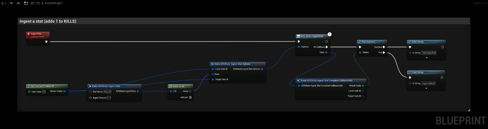
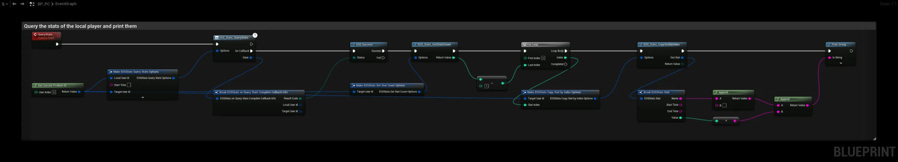

# Stats

:::info Video Tutorial is available
[Stats video](../videos/stats.mdx)
:::

Stats are numeric values per player (kills, wins, playtime) that EOS aggregates on the backend. Define them in the Developer Portal (**Game Services > Stats**) with an aggregation type (SUM, LATEST, MIN or MAX). [Leaderboards](./leaderboards.md) and stat based [Achievements](./achievements.md) are built on stats.

- [EOS Stats documentation](https://dev.epicgames.com/docs/game-services/eos-stats-interface)

## Requirements
- A logged in user with a **Product User Id** (Connect login)
- The **Stats** feature allowed in your client policy

## Common Nodes

| Node | Use |
|---|---|
| `EOS_Stats_IngestStat` | Sends one or more stat values. The backend aggregates them with the stat's aggregation type |
| `EOS_Stats_QueryStats` | Downloads the stats of a player |
| `EOS_Stats_GetStatsCount` + `EOS_Stats_CopyStatByIndex` | Reads the downloaded stats |
| `EOS_Stats_CopyStatByName` | Reads one downloaded stat by name |

## Notes
- Ingested values are added to the aggregation, they don't replace the stat (except LATEST). Ingest the change (for example `Kills = 1`), not the total.
- Stats are not updated immediately. Query them again after a short delay if you need the new value.

## Example

### Ingesting a stat

The **IngestKills** event adds 1 to the `KILLS` stat of the local player:

1. **Get Current Product Id** gives the Product User Id of the logged in player. Use it as both **Local User Id** and **Target User Id**.
2. Make one **EOSStats Ingest Data** per stat. **Stat Name** is the stat id from the Developer Portal, **Ingest Amount** is the change.
3. **EOS_Stats_IngestStat** sends the array. **EOS Success** splits the result code into **Success** and **Fail**.

You can send several stats in one call by adding more pins to **Make Array**.

### Reading stats

The **QueryStats** event downloads the stats of the local player and prints each one:

1. **EOS_Stats_QueryStats** downloads the stats. Leave **Stat Names** empty to get all stats, or add names to download only those.
2. When the query succeeds, **EOS_Stats_GetStatsCount** returns how many stats were downloaded.
3. The **For Loop** runs from 0 to count - 1 and **EOS_Stats_CopyStatByIndex** reads each stat. **Name** and **Value** are printed.

Use **EOS_Stats_CopyStatByName** instead of the loop when you only need one stat.

## Online Subsystem
The `EOSCore` Online Subsystem also implements `IOnlineStats` (`UpdateStats`, `QueryStats`).
