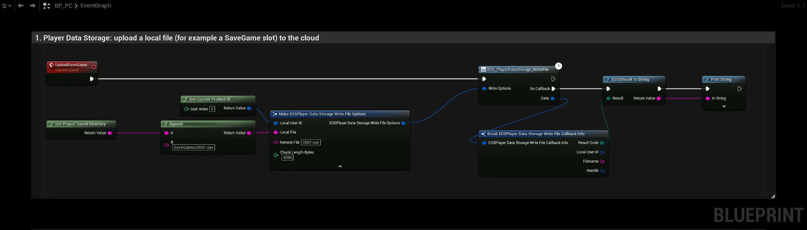
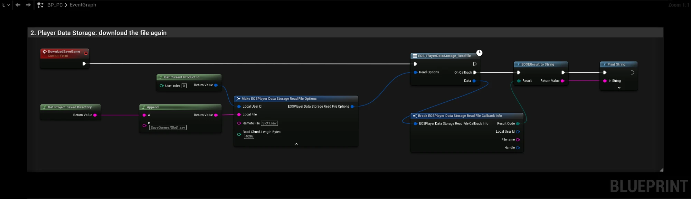
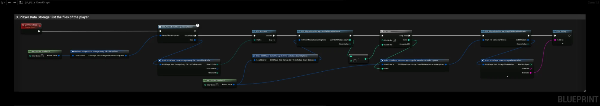
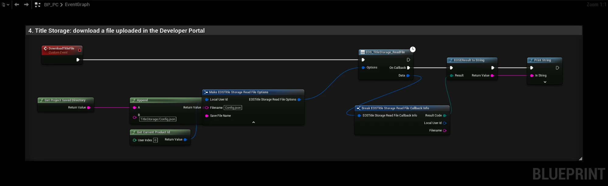

# Title Storage and Player Data Storage

EOS has two file services:

| | Title Storage | Player Data Storage |
|---|---|---|
| Who writes | You, in the Developer Portal | The player, from the game |
| Who reads | All players | Only that player |
| Typical use | Patch notes, configuration, news | Save games, settings |

Both encrypt files with the **Encryption Key** of your configuration, see [Project Settings](../settings_reference.md). Changing the key makes existing files unreadable.

- [EOS Title Storage documentation](https://dev.epicgames.com/docs/epic-online-services/player-and-game-data/title-storage-interface)
- [EOS Player Data Storage documentation](https://dev.epicgames.com/docs/epic-online-services/player-and-game-data/player-data-storage-interface)

## Title Storage

| Node | Use |
|---|---|
| `EOS_TitleStorage_QueryFileList` | Lists files with the given tags |
| `EOS_TitleStorage_GetFileMetadataCount` + `EOS_TitleStorage_CopyFileMetadataAtIndex` | Reads file names, sizes and hashes |
| `EOS_TitleStorage_QueryFile` / `EOS_TitleStorage_CopyFileMetadataByFilename` | Metadata of one file |
| `EOS_TitleStorage_ReadFile` | Downloads a file to a local file, with progress |
| `EOS_TitleStorage_DeleteCache` | Clears the local cache |

Files are uploaded in the Developer Portal under **Game Services > Title Storage**, with tags used by QueryFileList.

## Player Data Storage
See the step by step [SaveGames example](../examples/savegames/creating_savegame.md).

- Use **WriteFile** to upload a local file and **ReadFile** to download it. Use an absolute path for the local file.
- Run one read and one write at a time. Wait for the completion callback before you start the next transfer of the same kind.
- Files are limited in size and count per player, see the EOS documentation for the current limits.

## Example

### 1. Uploading a file

The **UploadSaveGame** event uploads `Saved/SaveGames/Slot1.sav`, the file the engine writes for **Save Game to Slot** with the slot name `Slot1`:

1. **Get Project Saved Directory** plus `SaveGames/Slot1.sav` gives the absolute path of the local file.
2. **Remote File** is the name of the file in the cloud.
3. **EOS_PlayerDataStorage_WriteFile** uploads the file. The result is printed with **EOS Result To String**.

### 2. Downloading a file

The **DownloadSaveGame** event downloads `Slot1.sav` again and writes it to the same local path. After a successful download you can load it with **Load Game from Slot**.

### 3. Listing the player's files

The **ListPlayerFiles** event prints the name of every file the player has uploaded:

1. **EOS_PlayerDataStorage_QueryFileList** downloads the file list.
2. **EOS_PlayerDataStorage_GetFileMetadataCount** returns the number of files.
3. The **For Loop** reads each file with **EOS_PlayerDataStorage_CopyFileMetadataAtIndex**. The metadata also has the size, the MD5 hash and the last modified time.

### 4. Downloading a Title Storage file

The **DownloadTitleFile** event downloads `Config.json`, a file you uploaded in the Developer Portal, to `Saved/TitleStorage/Config.json`. **Filename** is the name in Title Storage and **Save File Name** is the absolute local path. Title Storage files are read only for the game.
