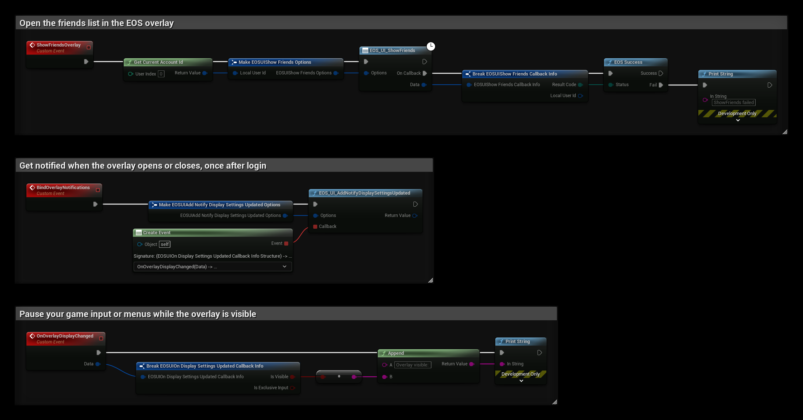

# Overlay (UI)

The UI interface controls the EOS overlay: the social overlay with the friends list, and the dialogs to block or report a player. The overlay needs an **Epic Account** login (Auth interface).

- [EOS UI documentation](https://dev.epicgames.com/docs/epic-account-services/eosui-interface)

:::note
The overlay is only drawn in a Standalone or packaged game, not in Play In Editor. The player can also open it with the toggle key, Shift+F3 by default.
:::

## Common Nodes

| Node | Use |
|---|---|
| `EOS_UI_ShowFriends`, `EOS_UI_HideFriends` | Opens or closes the friends list in the overlay |
| `EOS_UI_GetFriendsVisible` | True while the friends list is open |
| `EOS_UI_SetToggleFriendsKey`, `EOS_UI_GetToggleFriendsKey` | The key combination that opens the friends list |
| `EOS_UI_SetToggleFriendsButton`, `EOS_UI_GetToggleFriendsButton` | The gamepad button combination that opens the friends list |
| `EOS_UI_SetDisplayPreference` | Where on screen the overlay shows notifications |
| `EOS_UI_AddNotifyDisplaySettingsUpdated` | Called when the overlay opens or closes |
| `EOS_UI_ShowBlockPlayer`, `EOS_UI_ShowReportPlayer` | Opens the dialog to block or report a player |
| `EOS_UI_PauseSocialOverlay`, `EOS_UI_IsSocialOverlayPaused` | Stops the overlay from opening, for example during a cutscene |

## Example

1. The **ShowFriendsOverlay** event opens the friends list for the player from **Get Current Account Id**. **On Callback** is called when the overlay has opened, or with an error when it could not.
2. Call **BindOverlayNotifications** once after login. **EOS_UI_AddNotifyDisplaySettingsUpdated** then calls **OnOverlayDisplayChanged** every time the overlay opens or closes.
3. **Is Visible** is true while the overlay is shown, and **Is Exclusive Input** is true while it takes all input. Pause your game input or open your pause menu while it is visible.

See [Join Friends Game](../multiplayer/friends/join-friend-session.md) and [Join Friends Lobby](../multiplayer/friends/join-friend-lobby.md) for what happens when a player presses **Join** in the overlay.
