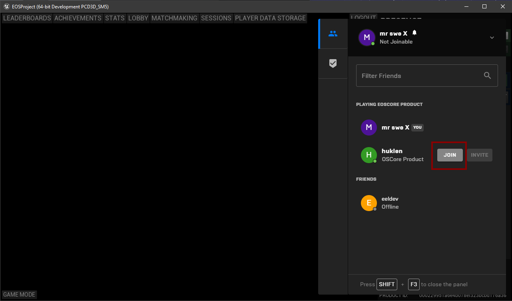
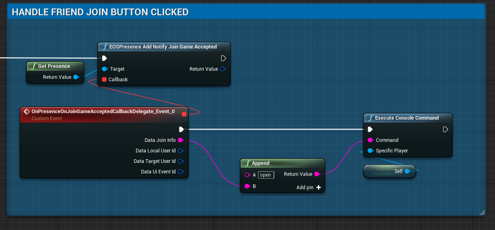

# Join Friends Multiplayer Game



## Bind the Event
To enable this functionality, all you need to do is to bind this delegate and join the session.



You can now join your friends from the Social Overlay!

## Online Subsystem (C++)
If you use the Online Subsystem session interface instead, pressing **Join** in the overlay calls `OnSessionUserInviteAccepted` with the friend's session as the search result, the same delegate that accepted invites use. Join it with `JoinSession`:

```cpp
SessionInterface->AddOnSessionUserInviteAcceptedDelegate_Handle(FOnSessionUserInviteAcceptedDelegate::CreateLambda(
	[SessionInterface](bool bWasSuccessful, int32 LocalUserNum, FUniqueNetIdPtr UserId, const FOnlineSessionSearchResult& SearchResult)
	{
		if (bWasSuccessful)
		{
			SessionInterface->JoinSession(LocalUserNum, NAME_GameSession, SearchResult);
		}
	}));
```

:::warning
Use either the Blueprint event above or the Online Subsystem delegate. If you bind both, both are called and the player joins twice.
:::