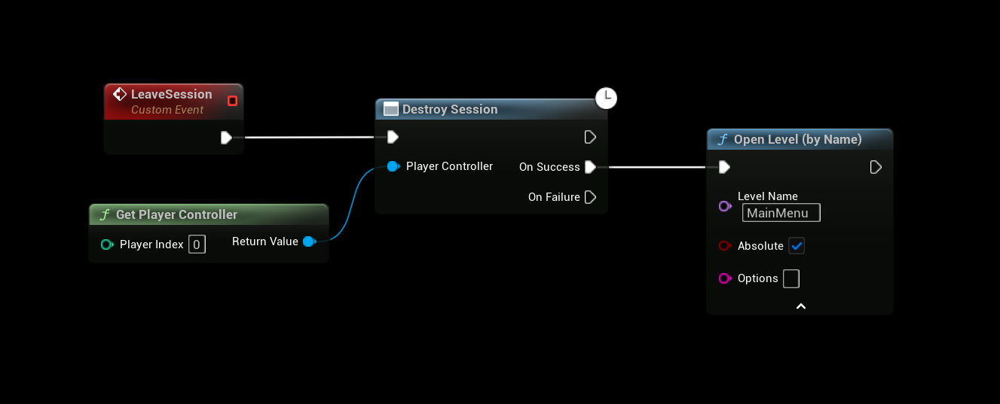

# Leaving a Multiplayer Session

This guide explains how to **properly leave** a multiplayer session in Unreal Engine using the **EOSCore** plugin. Failing to clean up a session correctly can prevent players from joining new sessions or cause network conflicts.

---

## Critical Rule: Always Call `DestroySession`

> **You must *always* call the `DestroySession` node when leaving a session — whether by player choice, or disconnection.**

Failing to do so will:
- Leave the session registered with Epic Online Services (EOS).
- Prevent the player from joining **any new session** until the game restarts.
- Cause "Session already exists" or "Join failed" errors.

---

## Where to Call `DestroySession`

The `DestroySession` node can be called from **anywhere** in your game:
- **Player Controller** (recommended for player-initiated leave)
- **Game Instance** (ideal for global cleanup)
- **UI Widget** (on "Leave Game" button press)

It does **not** matter where — only that it **is called**.

> **Important**: What `DestroySession` does depends on who calls it. On a **client** it only removes the session locally, the host and the other players are not affected. On the **host** (the session owner) it removes the session from EOS, so it no longer shows up in searches. See [Host Leaving](#notes) below.

---

## Example Blueprint Flow

```blueprint
[Player Clicks "Leave Game"]
   ↓
DestroySession
   ↓ (On Success)
Open Level → "MainMenu"
```



---

## When to Call `DestroySession`

| Scenario                        | Call `DestroySession`? |
|-------------------------------|------------------------|
| Player leaves via menu        | Yes                 |
| Disconnected by host/kick     | Yes                 |
| Network timeout               | Yes                 |
| Returning to main menu        | Yes                 |

---

## Best Practices

1. **Call on Level Transition**:
   - Use `Event End Play` or `On Destroyed` in your Player Controller to ensure cleanup.

2. **Handle Disconnections**:
   - Bind to **OnNetworkFailure** or **OnSessionFailure** events to auto-destroy.

3. **UI Feedback**:
   - Show "Leaving session..." while `DestroySession` completes.

4. **Error Handling**:
   - Even if `DestroySession` fails, proceed to the menu, but log the error. The local session stays registered until it is destroyed or the game restarts, so call `DestroySession` again before creating or joining a new session.

---

## Common Issues

| Problem                            | Cause                                 | Fix                              |
|------------------------------------|---------------------------------------|----------------------------------|
| "Cannot join session"              | Old session not destroyed             | Call `DestroySession`           |
| Stuck in "Joining..."              | Session cleanup skipped               | Add `DestroySession` on leave   |
| Multiple sessions in EOS Dashboard | Players not cleaning up               | Enforce `DestroySession`        |

---

## Notes

- **Host Leaving**: The rule above applies to players leaving. The host calls `DestroySession` only when the whole game ends, because it removes the session for everyone. To stop the match but keep the session, use `EndSession` instead.
- **Testing**: Use **Standalone Game** instances to verify cleanup in logs.

---

> **Remember**: `DestroySession` = **Mandatory** for clean session lifecycle.