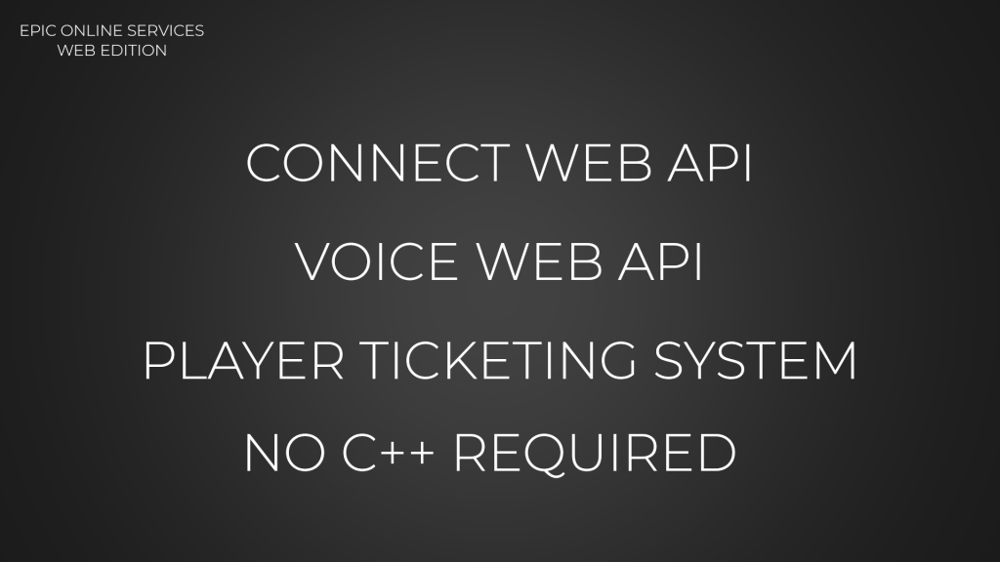
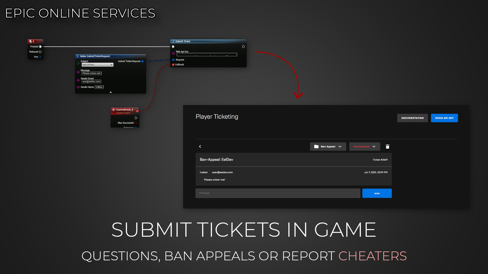

import Tabs from '@theme/Tabs';
import TabItem from '@theme/TabItem';

# Web API

EOSCore includes the **EOSCoreWeb** module, Blueprint functions for the [EOS Web API](https://dev.epicgames.com/docs/web-api-ref). The Web API is a set of HTTP services next to the EOS SDK, used to create voice room tokens, submit player tickets, manage sanctions and more.

The module is part of the EOSCore plugin and loads on Win64, Linux, Mac, Android and iOS. There is nothing extra to install or enable. The functions are found under **EOSCoreWeb** in the Blueprint context menu.

<Tabs>
  <TabItem value="image" label="Image" default>
    
  </TabItem>
  <TabItem value="image2" label="Image 2">
    
  </TabItem>
</Tabs>

## Functions

| Category | Function | Use |
|---|---|---|
| Auth | `InitiateEpicAuthentication` | Opens a web browser for Epic Account login and returns the authorization code, see [Auth](./auth.md). Not available on mobile |
| Auth | `RequestAuthAccessToken` | Exchanges a code, exchange code, refresh token or password for an Epic Account access token |
| Connect | `RequestAccessToken` | Requests an access token with client credentials. Needed for Voice, Sanctions and Anti-Cheat |
| Voice | `CreateRoomToken`, `RemoveParticipant`, `ModifyParticipant` | Creates tokens for players to join a voice room, removes or hard mutes a participant, see [Voice Chat (RTC)](../multiplayer/voice-chat/voice-chat_rtc.md) |
| Ticketing System | `SubmitTicket` | Submits a player ticket with the Web API key of your product, see [Player Tickets](../examples/player_tickets.md) |
| Sanctions | `CreateSanction`, `RemoveSanction`, `QuerySanctions`, `QuerySanctionsForPlayer`, `QueryActiveSanctionsForSpecificPlayer` | Creates, removes and lists sanctions (bans) |
| Sanctions | `CreateSanctionAppeal`, `QuerySanctionAppeals`, `SynchronizeSanctionsToAnExternalService` | Appeals and sanction sync |
| Anti-Cheat | `QueryAntiCheatServiceStatusByDeployment` | Returns the status of the Anti-Cheat service for a deployment |
| Utility | `GetPublicIp` | Returns the public IP address of the client, for example for `CreateRoomToken` |

## Access Tokens
Most functions take an **Access Token**. Get it from **RequestAccessToken** with the **Client Id** and **Client Secret** of a client in the Developer Portal, under **Product Settings > Clients**. The client policy decides which Web API features the token can use, for example voice or sanctions.

:::caution
The client secret gives access to everything its client policy allows. Functions such as `CreateSanction` and `CreateRoomToken` are meant for a dedicated server or a tool you trust, do not ship a client secret with permissions like these in the game client.
:::

## Logging
Add `LogEOSCoreWeb=Verbose` to `[Core.Log]` to log the requests and responses, see [Additional Logging](../additional_logging.md).
